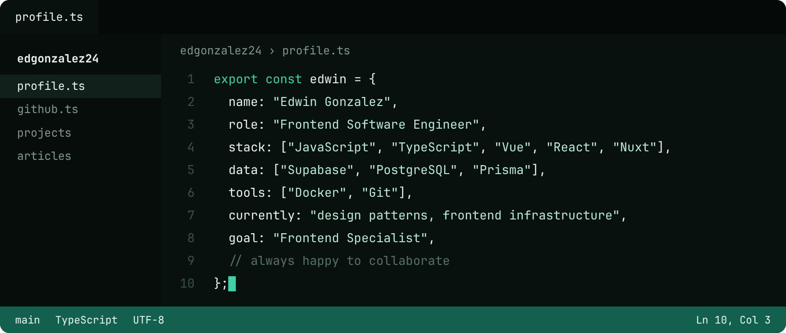
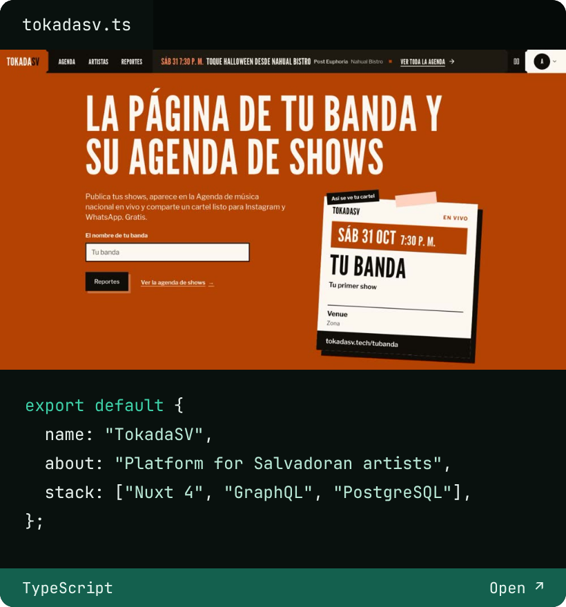
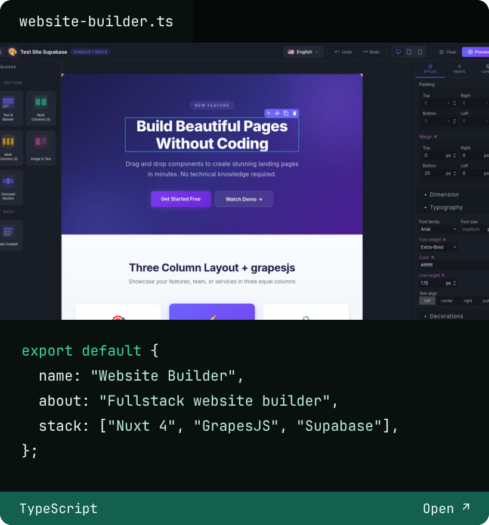
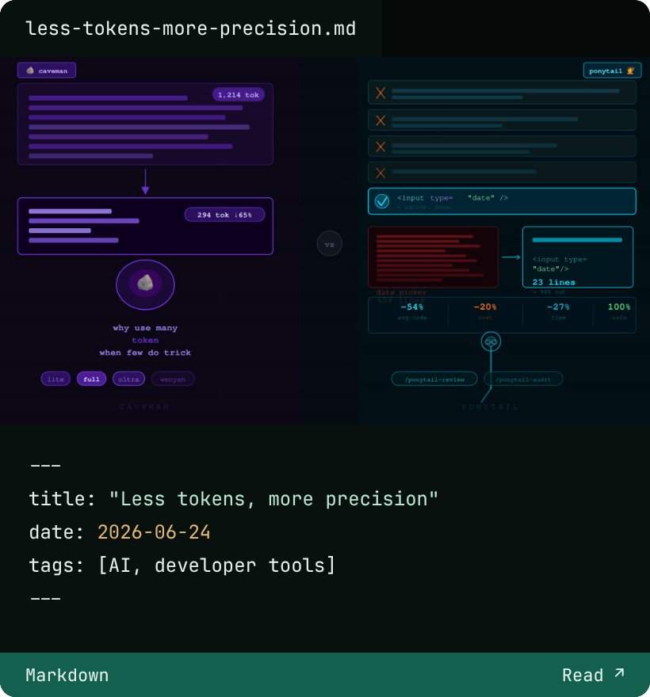
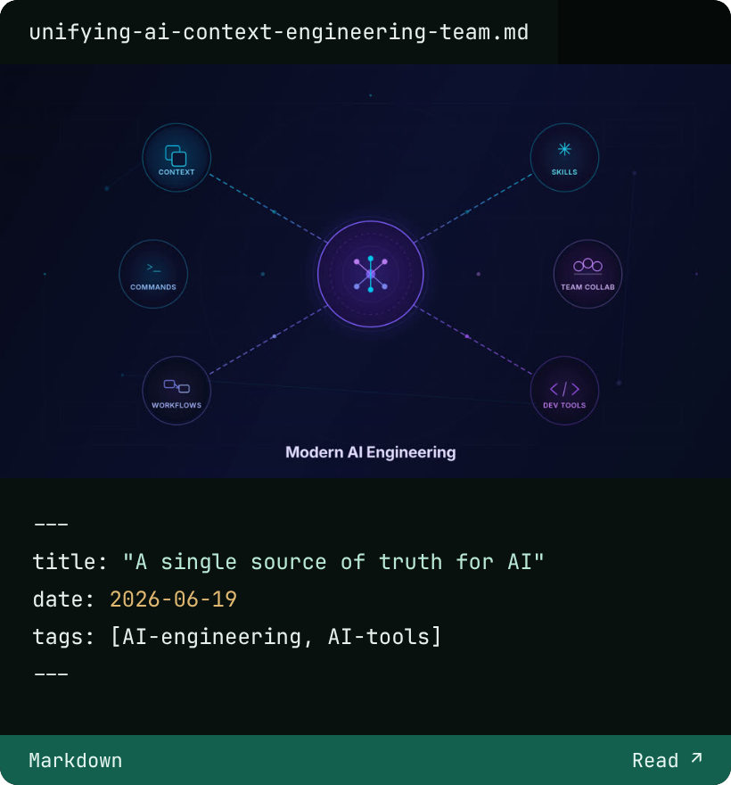
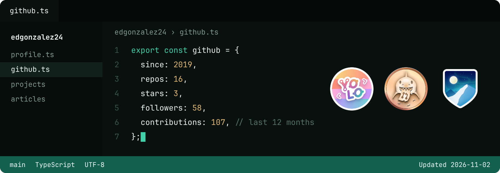

[Portfolio](https://edgonzalez-me.vercel.app/) · [LinkedIn](https://www.linkedin.com/in/edwin-gonz%C3%A1lez-54162618a/) · [X](https://twitter.com/_tuxgonzalez) · [Medium](https://medium.com/@tuxdev)

## Projects

 

[All projects →](https://edgonzalez-me.vercel.app/projects)

## Latest posts

 

[All posts →](https://edgonzalez-me.vercel.app/articles)

## GitHub

[github.com/edgonzalez24 →](https://github.com/edgonzalez24)
